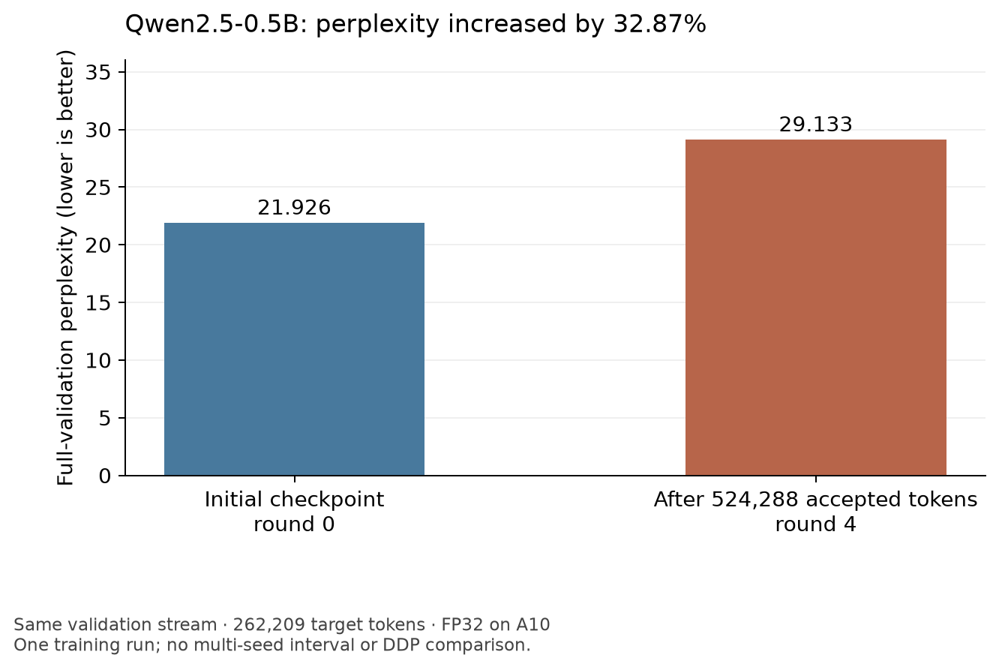
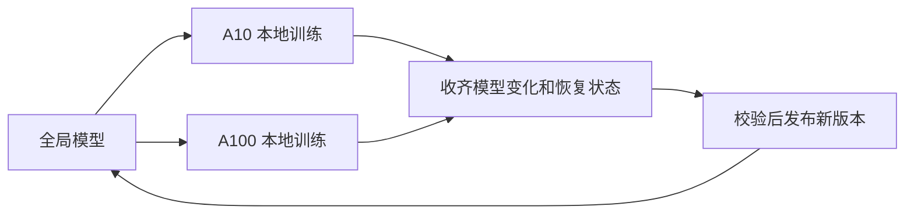

# TideTrain research：怎样读过程与证据

TideTrain 尝试在网络受限、可能被回收的 GPU 上训练语言模型。重点是：机器中途消失时，怎样保住已经接受的训练进度，并从完整状态继续。

这轮完成了两卡训练和恢复验证，没有完成真实千卡实验。千卡阶段选错了资源入口：提交的是 Merlin／Arnold Job 的 1000 卡需求，并没有扩成用户要求的 Spot-UCE 预约。用户随后停止该任务，本轮已暂停。旧文档中的“queued”“观察进程存活”都是当时快照。

## 先看三个答案

| 想知道什么 | 实际证据 | 能得出的答案 |
| --- | --- | --- |
| 训练中断后能恢复吗？ | 两个真实单 GPU 槽位完成四轮；另一 A10 实例重放其中一轮，结果逐项一致 | 该轮的模型变化、优化器、随机状态和数据位置可以完整恢复 |
| 模型效果改善了吗？ | 相同完整验证集上，perplexity（困惑度，越低越好）从 21.926 增到 29.133 | 这次效果变差，增加 32.87% |
| 能在千卡上运行吗？ | 只提交过资源需求；另有本机 1000 逻辑客户端测试 | 尚未取得千卡训练证据 |



图中数值越低越好。只观察了一个训练实验，没有测多个随机种子的波动；恢复正确不能抵消这个质量退化。完整设置在[两卡实验报告](results/qwen05b-4round/REPORT-friendly.md)。

## 它怎样保住训练进度

一个 GPU 槽位是一个逻辑训练参与者。平台可以给这个服务保留多个副本，但训练时必须明确选择哪个实例代表这个槽位。此实验保留过 8+8 个副本，实际算法参与者只有两个。

每一轮，两块 GPU 从同一份全局模型出发，各自训练 128 步，然后交回模型的改变量。CPU 控制器收到并核验全部恢复状态后，才发布新的全局版本。Token 是模型处理的文本单元，不等同于一个词或一个汉字。只有被接受进新版本的 token 才算有效训练量。



恢复时不仅要有模型参数，还要有 Adam 的历史状态、随机数状态和读到了哪段数据。否则程序虽然能继续跑，后面的更新可能已不等于原实验。

## 结果中的数字该怎样读

四轮累计 524,288 个被接受 token。21 个唯一训练状态对象通过远端哈希核验，合计 67.192 GB。C3 是恢复后的一个控制会话，它用 4,401.539 秒接受新增 393,216 token，即 89.336 token/s；这不是稳定态吞吐，更不是相对 DDP 的加速倍数。

后续改造把大张量拆成小块归约，真实 Qwen 权重的 CPU 数学审计误差为 0、峰值 RSS 为 1.61 GiB。该审计用合成更新，没有训练模型。另一项 localhost 测试在 64 并发下处理 1000 个逻辑客户端，两轮耗时 69.237 秒；它没有使用 GPU，也没有跨 1000 台机器。

## 研究分支应该怎样读

[阅读地图](docs/READING_GUIDE-friendly.md)按目的列出全部易读版。[部署说明](docs/HTTP_DEPLOYMENT-friendly.md)解释 CPU 和 GPU 怎样通信；[扩展计划](docs/SCALE_PLAN-friendly.md)解释为什么增加卡数还不够；[方法调研](research/LITERATURE_REVIEW-friendly.md)比较低频同步、异步和压缩。需要核对历史时，再打开各页附带的原文。

## 简历里可以怎样讲

场景是低带宽、可抢占资源上的训练中断。负责的目标是让旧实例、重复结果和不完整上传不能错误推进模型版本。实现了内容寻址、结果去重、状态持久化、冷缓存恢复及分片归约，并完成真实 GPU 和独立重放验证。结果应写成训练系统的恢复正确性；不能写成模型效果提升或已完成千卡训练。

## 两个分支放在同一个目录

`main` 放代码和核验后的结果，`research` 保留调研、手稿、对话和失败记录。Git worktree 可以让两个分支同时打开：

```bash
mkdir -p ~/projects/TideTrain
cd ~/projects/TideTrain
git clone https://github.com/Cheongroach/tidetrain.git main
git -C main fetch origin
git -C main worktree add ../research -b research origin/research
git -C main worktree list
```

若本地已经有 `research` 分支，最后的添加命令改为 `git -C main worktree add ../research research`。同一分支不能在两个 worktree 中同时检出；删除工作区前先保存改动。

---

原文：[README.md](README.md)。保留发布时的说明、数字与分支安排。

阅读版整理于 2026-10-26；历史状态不作当前运行承诺。
