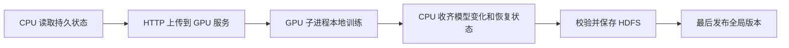

# CPU 与 Spot GPU 怎样通信和保存状态

这个入口服务于网络受限的训练实验：GPU 容器只能使用镜像、平台下发的模型目录和本地盘，不能直接读取 HDFS 或挂载 ByteNAS。CPU 控制端负责调用 GPU，并将结果保存到持久存储。

这是原两卡基线的部署说明。曾在开发机控制端完成真实 GPU 实验，但 Dorado Executor 本身的网络和身份未完成实测；文档里的旧订单、镜像版本和时限都是历史配置。本轮已暂停，不能按原文的“下一步”直接重新申请资源。

## 一轮训练的数据从哪里走



delta 是本轮参数改变量。CPU 必须先拿齐它和恢复对象，再发布持久结果。这样 GPU 实例随后消失，也不会让一份已接受更新只剩一半产物。

| 对象 | 用途 |
| --- | --- |
| 参数 | 当前模型本身 |
| delta | 此轮训练后参数减去起始参数 |
| Adam 状态 | 优化器用于后续更新的历史量 |
| RNG 状态 | 随机数发生器状态，确保恢复随机过程 |
| cursor | 数据读到的位置 |
| manifest | 引用这些文件的清单；最后发布它才算提交 |

每次 GPU 服务启动有新的实例 UUID；同一个 IP 被复用时，UUID 不同就不能冒充原实例。dispatch generation 是同一槽位重新派发任务的代次，旧代结果不再被接受。

## 部署之前实际需要准备什么

平台绑定一个完整解包目录，含 `package-manifest.json`、配置、assets、wheels 和代码。不要将 tar 路径当成模型目录。旧包曾发布 48 个文件并逐个校验，但新环境仍需要校验自己的包。

控制端需要 CPU PyTorch、HDFS CLI 和到 GPU 服务端口的访问能力。GPU 使用镜像中的 PyTorch，启动时离线装其余依赖；它不临时从网络下载模型。

| 配置 | 正确理解 |
| --- | --- |
| `LOWBAND_PACKAGE_DIR` | 平台解包目录；原入口从 `BERNARD_MODEL_PATH` 取得 |
| `LOWBAND_RUN_ID` | 本次实验身份；恢复已提交实验时保持一致 |
| `LOWBAND_HTTP_TOKEN` | 控制端与 worker 相同的随机凭据，由受控环境注入，不能写进 Notebook |
| `LOWBAND_ZONE` | `hl`／`lf` 是逻辑槽位标签，不能据此断言实际机房 |
| `LOWBAND_HTTP_PORT` | 未指定时读取平台 `PORT0`；必须实际验证网络可达 |
| `LOWBAND_SERVICE_SECONDS` | 单进程寿命，不能代替平台预约到期或副本释放 |

示例启动命令仅用于理解旧两卡基线，不是当前已暂停实验的自动续跑指令：

```bash
timeout --signal=TERM --kill-after=30s 10770s /bin/bash -lc   'set -euo pipefail; export LOWBAND_PACKAGE_DIR="${BERNARD_MODEL_PATH:?missing model path}"; test -s "$LOWBAND_PACKAGE_DIR/package-manifest.json"; exec /bin/bash "$LOWBAND_PACKAGE_DIR/lowband_training/http_service_entry.sh"'
```

当时 worker 为 10,740 秒、外层命令 10,770 秒。旧三小时预约预算不能当成现在一周排队策略；排队期限、进程寿命和累计卡时要分开配置。

## 哪些检查能证明启动成功

`/health` 只能说明 HTTP 服务活着。依次核对实例身份、运行文件完整性、CUDA BF16 运算、实际训练子进程、delta／恢复产物、持久化全局版本。网页选择“HTTP debug 协议”不代表程序已经监听 `PORT0`。

没有端点时只等待交付，不开始训练；有端点也不能根据数量自动扩大训练 world size。`GPU_COUNT` 之类本地变量不会申请显卡。CPU 的 HTTP/HDFS 1 MiB 回环验证的是数据通路，不是完整 GPU 训练。

## 恢复时不能改变什么

原 run 的配置身份和截止时间不可变。新窗口应创建新的 run，只继承已提交历史，不继承正在飞行的 dispatch 或未接受更新。此基线依靠唯一活跃控制器；本地文件锁不能防跨主机双主。

控制器退出后 GPU 租约到期终止任务；默认续租窗口 120 秒。大对象 get／put 最多 900 秒且受剩余 deadline 约束。Qwen 0.5B 每个 worker 的 FP32 delta 约 1.84 GiB，Adam 恢复约 3.68 GiB，传输和 CPU staging 是实质开销。

原基线按顺序上传和回收两侧文件，两块 GPU 可以同时计算；没有实现传输流水线或区域聚合。新 `scale_worker` 容量路径反过来主动访问 CPU 网关，不能直接照用本页的服务发现配置。

## 结束意味着什么

`completed.json` 表示模型状态已提交，不表示预约或部署副本已释放。需要另核对平台资源终态。Spark 如参与，只负责可幂等重试的分片工作；有状态训练／提交循环仍应只有一个所有者。

[Notebook 易读入口](../../lowband_training/dorado_http_training-friendly.md)解释各单元格做什么；[两卡终验](../../results/qwen05b-4round/REPORT-friendly.md)说明真正完成的训练；[原始部署说明](HTTP_DEPLOYMENT.md)保留具体字段和历史过程。

---

原文：[HTTP_DEPLOYMENT.md](HTTP_DEPLOYMENT.md)。保留历史操作、配置或研究推导，便于核对当时状态。

阅读版整理于 2026-10-26；历史状态不作当前运行承诺。
