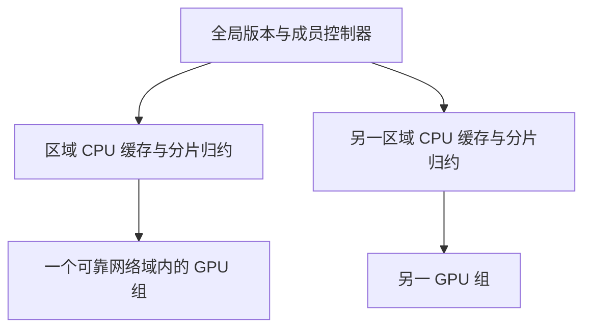

# 增加 GPU 时还要解决什么

想扩到百卡、千卡，至少要回答：数据能否送到每个参与者？慢节点和被抢占节点怎样处理？在相同训练量下，模型质量是否可接受？本轮两卡恢复实验完成，但质量退化；真实千卡资源未取得，扩展执行已暂停。

## 先看单卡每轮要传什么

FP32 是 32 位浮点保存方式。设参数量为 P=494,032,768，FP32 每个参数 4 bytes，所以一份参数大小 D=4P=1,976,131,072 bytes，约 1.84 GiB。

以下 GB／TB 分别按 10⁹／10¹² bytes 计，GiB 按 2³⁰ bytes 计。

当前 warm round 指已有前轮恢复状态的一轮。它向单卡参与者下发参数 D 和 Adam 两个矩约 2D，回收模型变化 D 和新的 Adam 状态约 2D，共约 6D=11.857 GB。随机状态、元数据、序列化和重试还要另计；首轮没有旧 Adam 下发，约 4D。

| 假设设置 | 参与训练的 GPU | 独立训练组数 | 每 warm round 状态预算 | 中央 10 Gbit/s 串行理想时间 |
| --- | ---: | ---: | ---: | ---: |
| 每卡独立 | 100 | 100 | 1.186 TB | 949 秒 |
| 每卡独立 | 1000 | 1000 | 11.857 TB | 9485 秒 |
| 每组 8 卡共享一份组状态，设计假设 | 104 | 13 | 154 GB | 123 秒 |
| 每组 8 卡共享一份组状态，设计假设 | 1000 | 125 | 1.482 TB | 1186 秒 |

时间按 `bytes × 8 / 10^10` 计算，没有协议和磁盘开销，且假设中央串行通道满速。它是字节契约推导，不是网络实测。13 个八卡组实际是 104 卡；组内同步和组状态共享也尚未实现。

## 本地训练的结果怎样合并

沿用原实现的记号：全局参数为 θ，每组训练后改变量为 Δᵢ=θᵢ−θ，该组被接受的 token 数为 nᵢ。先按 token 数加权形成 g，再更新外层动量 m：

$$
g=-\frac{\sum_i n_i\Delta_i}{\sum_i n_i},\qquad
m_{t+1}=\mu m_t+g,\qquad
\theta_{t+1}=\theta_t-\eta(g+\mu m_{t+1}).
$$

η 是外层学习率，μ 是外层动量系数，H 是每轮本地训练步数。这里的 g 由多个本地训练步骤的参数变化构造，不是“在同一全局参数处算出的真实梯度”。所以即使 H=1，带外层 optimizer 的这一实现也不能直接叫 DDP。评测对象是最后提交的全局 θ，不是某个 worker 尚未合并的本地模型。

## 已实现的分片解决了什么

张量是存放模型参数或状态的多维数组。把大张量拆成小 chunk，归约时只拿当前 chunk，能降低中央 CPU 内存和单次请求大小。真实 Qwen 权重的 CPU 合成更新检查逐 bit 一致，峰值 RSS 1.61 GiB。[审计数据](../results/scale-20261025/qwen-shard-audit.json)。

它没有自动把 6D 变小，也没有保证 worker 只用 chunk 大小的内存：worker 仍完整加载模型和 Adam。降低总字节还需要让恢复状态留在区域、复用 GPU 上的 optimizer，或另做压缩；这些改变都需重新验证恢复边界。

原两卡 C3 会话中，319 次 HDFS CLI 调用累计 2,143.189 秒；每次调用要启动进程，因此存储操作本身也可能成为开销。此数字是该会话记录，不是纯传输基准。

目前控制权由一个宿主机上的 SQLite WAL 保存。租约是带有效期的使用权；fence 是每次换实例递增的编号，用来拒绝旧实例；CAS 表示只有版本仍等于读取时版本才允许提交。它们解决同一权威账本的唯一接受问题，不构成跨主机共识或高可用。

## 后续架构为什么要分层

这是待实现的结构。全局只决定成员和版本，区域缓存分发模型、保留当地 optimizer，并归约参数分片。实际代码仍只有单网关，多区域结构尚待实现。

原两卡 HTTP 基线由 CPU 主动调用 GPU 服务；新容量入口由 GPU worker 主动调用 CPU 网关。两条路径的网络权限和发现方式不同，不能直接互换配置。

## 怎样判断通信是否值得减少

设每轮本地训练 H 步、每步 t 秒，传输加提交耗时 C 秒，则计算占比近似为 Ht/(Ht+C)。若希望达到 80%，需 Ht≥4C。增加 H 可以摊薄通信，却也让各组参数偏离更多，质量必须在相同 token 预算下重测。

合成 localhost 的 1000 客户端测试完成两轮、耗时 69.237 秒，只验证本机 HTTP／账本接受链路，不是上述 C 的千节点网络测量。

## 质量和故障必须各自验收

数据游标只随接受更新推进。迟到 worker 若没被接受，下一轮不能假装它已经读完数据；成员变化必须显式保存。降低等待门槛的 quorum 意味着允许部分成员提交，可能改变数据覆盖，不是无代价的“去掉 barrier”。

固定 token、语料版本、初始模型和验证集，分别比较同步 DDP、同步 local-SGD、异步片段与压缩配置，使用多个随机种子。现有 WikiText-2 训练流只有 2,517,232 token；1000 个独立单卡每轮 65,536,000 token 会大量重复读数据，适合协议容量检查，不足以直接做大规模质量结论。

## 恢复执行时先决定什么

用户要求直接上千卡，小规模诊断不再是资源申请前置条件；但是实际训练资源必须从正确入口取得。此前 Merlin／Arnold 需求没有完成用户要的 Spot-UCE 预约，用户已停止尝试。先确认入口，再保持一周调度窗口；已分配节点集合等待六小时，全员就绪后才计 45 分钟容量计算。资源预算和实际 GPU·h 分别记录。

默认开发机若不足，Dorado Spark 可用于独立、幂等的分片检查；唯一控制器不能放进可重复执行的 Spark task。新 8C32G 开发机可以隔离其他进程，但不会消除本算法的内存或中央带宽下限。

方法依据见[调研](https://github.com/Cheongroach/tidetrain/blob/research/research/LITERATURE_REVIEW-friendly.md)，已完成证据见[执行报告](../results/scale-20261025/REPORT-friendly.md)。

---

原文：[SCALE_PLAN.md](SCALE_PLAN.md)。保留历史操作、配置或研究推导，便于核对当时状态。

阅读版整理于 2026-10-26；历史状态不作当前运行承诺。
